  

  

  
  
  

  

## About me

I'm a Software Engineer specializing in scalable web applications and modern frontend architecture. I work mostly with Angular, TypeScript and NestJS, build cross-platform apps with Ionic and Tauri, and reach for Rust and WebAssembly when performance matters. I care about clean architecture, performance, maintainability and solid engineering practices.

<pre>
name: Hamed Rasouli
title: Software Engineer
email: hrasouli.work@gmail.com
stack:
  [
  "Angular",
  "TypeScript",
  "NestJS",
  "Ionic",
  "Tauri",
  "Rust",
  "WebAssembly"
  ]
focus:
  [
  "Frontend architecture",
  "Clean architecture",
  "Performance",
  "Maintainability"
  ]
available_for: freelance projects
</pre>

## How I work

<table>
  <tr>
    <td width="33%" valign="top">
      <h3>Architecture first</h3>
      Clear boundaries, typed contracts and a structure that still makes sense when the team and the codebase grow.
    </td>
    <td width="33%" valign="top">
      <h3>Performance by default</h3>
      Small bundles, fast first paint and smooth interaction, measured instead of guessed.
    </td>
    <td width="33%" valign="top">
      <h3>Built to maintain</h3>
      Readable code, tests where they count and documentation the next engineer will actually use.
    </td>
  </tr>
</table>

## Tech stack

  <picture>
    <source media="(prefers-color-scheme: dark)" srcset="assets/stack-dark.svg">
    <source media="(prefers-color-scheme: light)" srcset="assets/stack-light.svg">
    
  </picture>

## Featured project

**[Hyalo](https://github.com/HamedRsl/Hyalo)** is a free, open-source liquid glass UI kit for Angular. It is built on Angular Aria and the CDK, signal based, zoneless and safe to render on the server, and it works with a keyboard and a screen reader out of the box.

 

## Work with me

I'm open to freelance work. If you need a web application that is built to scale and easy to maintain, from a product site to a full platform, send me an [email](mailto:hrasouli.work@gmail.com) or a message on [Telegram](https://www.t.me/hamedrsl).

  <picture>
    <source media="(prefers-color-scheme: dark)" srcset="https://raw.githubusercontent.com/HamedRsl/HamedRsl/output/snake-dark.svg">
    <source media="(prefers-color-scheme: light)" srcset="https://raw.githubusercontent.com/HamedRsl/HamedRsl/output/snake-light.svg">
    
  </picture>

  

